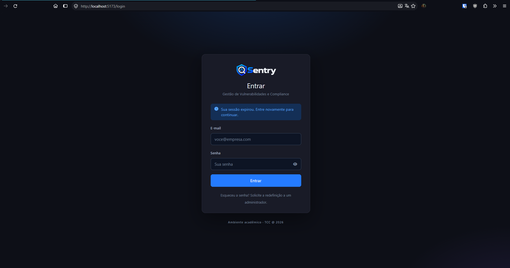
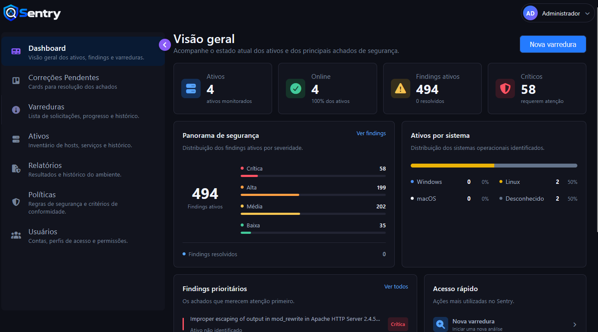
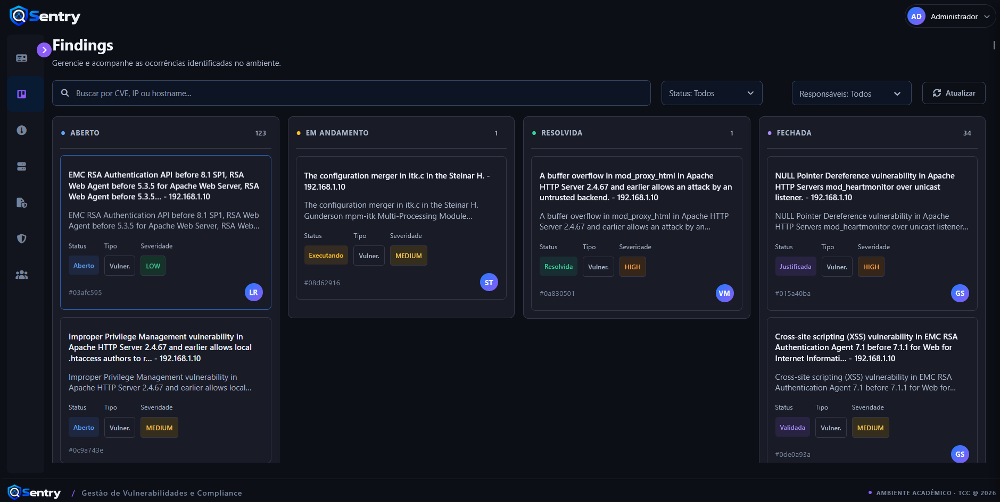
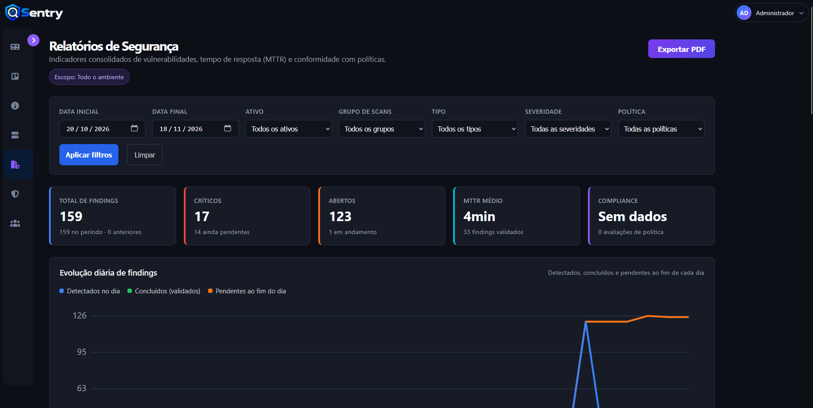

# Sentry 

Plataforma acadêmica para **descoberta de ativos, identificação de vulnerabilidades, avaliação de configurações de segurança e acompanhamento de findings** em ambientes de rede controlados e autorizados.

<div align="center">


</div>

<br>

<div align="center">






</div>


## Sobre o projeto

[](https://gitdiagram.com/gustavoolsantos/sentry?utm_source=readme&utm_medium=badge)

O **Sentry** é um Trabalho de Conclusão de Curso (TCC) desenvolvido na linha de **desenvolvimento e segurança da informação**.

A plataforma centraliza o ciclo de análise de ativos de rede: recebe solicitações de varredura, processa os alvos de forma assíncrona, interpreta os resultados do Nmap, correlaciona os serviços encontrados com vulnerabilidades conhecidas no NVD, executa verificações de políticas e transforma os resultados em **Findings** persistidos e acompanháveis.

Além da análise técnica, o sistema disponibiliza histórico das execuções, reconciliação de findings, gerenciamento de responsáveis, dashboard, políticas de segurança e uma área de **relatórios com indicadores, evolução de risco, MTTR, compliance e exportação em PDF**.

> [!WARNING]
> O Sentry é um projeto acadêmico. Utilize-o exclusivamente em máquinas, redes e serviços para os quais exista autorização explícita para realização de testes.

---

## Objetivos

### Objetivo geral

Desenvolver uma plataforma capaz de auxiliar na identificação, organização, análise e acompanhamento de riscos de segurança encontrados em ativos de rede.

### Objetivos específicos

- Executar varreduras de um ou mais alvos autorizados.
- Processar alvos de forma assíncrona utilizando RabbitMQ.
- Identificar hosts, portas, serviços e versões.
- Extrair informações CPE fornecidas pelo Nmap.
- Consultar o NVD para identificar vulnerabilidades relacionadas aos CPEs.
- Detectar configurações potencialmente inseguras.
- Aplicar regras e políticas de segurança.
- Normalizar vulnerabilidades e violações em objetos `Finding`.
- Persistir scans, ativos, serviços, vulnerabilidades, políticas e findings.
- Reconciliar findings entre diferentes execuções para reduzir duplicidades.
- Controlar o ciclo de vida dos findings.
- Permitir atribuição de responsáveis aos achados.
- Disponibilizar autenticação e controle de acesso.
- Apresentar os resultados em uma interface web.
- Consolidar resultados em relatórios e documentos PDF.

---

## Funcionalidades

### Varredura e descoberta

- Varredura de múltiplos alvos.
- Validação dos alvos informados.
- Execução do Nmap como processo externo.
- Timeout configurável para evitar processos indefinidamente ativos.
- Parsing do XML produzido pelo Nmap.
- Descoberta de:
  - hosts;
  - portas;
  - estados das portas;
  - serviços;
  - versões;
  - informações de sistema operacional quando disponibilizadas pelo Nmap;
  - CPEs.

### Processamento assíncrono

As solicitações são processadas através do **RabbitMQ**, permitindo que diferentes alvos de uma mesma solicitação sejam processados independentemente.

A implementação contempla:

- publicação assíncrona;
- publisher confirms;
- publisher returns;
- retry para falhas transitórias;
- distinção entre falhas transitórias e permanentes;
- tratamento de mensagens rejeitadas;
- agrupamento através de `ScanExecutionGroup`;
- controle de estado das execuções.

A configuração atual utiliza até **3 tentativas de publicação**, com intervalo inicial de 1 segundo, multiplicador 2 e intervalo máximo de 5 segundos.

### Vulnerabilidades

- Consulta à **NVD API 2.0**.
- Correlação por CPE.
- Mapeamento das respostas do NVD para o domínio da aplicação.
- Persistência das vulnerabilidades identificadas.
- Associação de vulnerabilidades aos ativos e serviços encontrados.
- Tratamento da indisponibilidade/limitação da consulta ao NVD sem interpretar automaticamente a ausência de resposta como ausência de vulnerabilidades.

### Políticas de segurança

O sistema possui uma arquitetura baseada em regras (`ConfigCheck`) para avaliação de configurações e políticas.

Entre as verificações implementadas estão:

- certificados expirados;
- portas de bancos de dados expostas;
- SSH exposto;
- regras baseadas em portas e serviços.

A estrutura permite adicionar novas verificações sem alterar o fluxo principal de processamento do scan.

### Findings

Vulnerabilidades e violações de políticas são normalizadas em um modelo único de `Finding`.

Um finding pode conter:

- ativo relacionado;
- serviço;
- vulnerabilidade;
- regra de política;
- tipo;
- severidade;
- status;
- título;
- descrição;
- evidências;
- data de detecção;
- responsável;
- informações de resolução/validação.

O sistema utiliza **fingerprints e reconciliação** para relacionar ocorrências encontradas em diferentes scans e evitar a criação indiscriminada de registros duplicados.

### Relatórios

A plataforma possui um módulo dedicado de relatórios, com filtros por período, ativo, grupo de scans, scan, severidade, tipo, status e política.

Os relatórios disponibilizam:

- resumo consolidado;
- distribuição de findings;
- findings relevantes;
- evolução do risco ao longo do tempo;
- findings detectados, resolvidos e pendentes;
- MTTR (*Mean Time to Remediate/Resolve*);
- indicadores de compliance por política;
- exportação de relatório em PDF.

Endpoints principais:

```text
GET /reports/summary
GET /reports/risk/evolution
GET /reports/findings/distribution
GET /reports/findings/relevant
GET /reports/mttr
GET /reports/compliance
GET /reports/pdf
```

### Autenticação e usuários

O sistema utiliza **Spring Security + JWT** para autenticação e autorização.

Inclui:

- login;
- emissão de JWT;
- controle por roles;
- gerenciamento de usuários;
- criação, edição e remoção de usuários;
- alteração de senha;
- políticas de senha;
- criação inicial de administrador configurável.

### Interface web

O frontend em React possui telas para:

- dashboard;
- autenticação e perfil;
- novo scan;
- grupos e detalhes de scans;
- hosts/ativos;
- findings em quadro Kanban;
- políticas e regras;
- usuários;
- relatórios;
- páginas de acesso negado e rota inexistente.

---

## Arquitetura

O fluxo principal do sistema é:

```text
┌──────────────────────┐
│      React / Web     │
└──────────┬───────────┘
           │ HTTP / REST
           ▼
┌──────────────────────┐
│   Spring Boot API    │
│                      │
│ Auth / Scan / Asset  │
│ Finding / Policy     │
│ Reports              │
└───────┬──────────────┘
        │
        ├───────────────────────┐
        │                       │
        ▼                       ▼
┌──────────────────┐    ┌───────────────────┐
│      MySQL       │    │     RabbitMQ      │
│                  │    │                   │
│ Scans            │    │ Scan messages     │
│ Assets           │    │ Retry             │
│ Services         │    │ Publisher confirm │
│ Findings         │    └────────┬──────────┘
│ Vulnerabilities  │             │
│ Policies         │             ▼
│ Users            │    ┌───────────────────┐
└──────────────────┘    │  Scan Consumer    │
                        └────────┬──────────┘
                                 │
                                 ▼
                        ┌──────────────────┐
                        │      Nmap        │
                        └────────┬─────────┘
                                 │ XML
                                 ▼
                        ┌──────────────────┐
                        │  Nmap XML Parser │
                        └────────┬─────────┘
                                 │
                    ┌────────────┴────────────┐
                    ▼                         ▼
             ┌──────────────┐         ┌────────────────┐
             │   Policies   │         │      NVD       │
             │  Evaluation  │         │  CPE / CVEs    │
             └──────┬───────┘         └───────┬────────┘
                    │                         │
                    └───────────┬─────────────┘
                                ▼
                         ┌──────────────┐
                         │   Findings   │
                         └──────┬───────┘
                                ▼
                       ┌──────────────────┐
                       │ Reconciliation   │
                       └──────┬───────────┘
                              ▼
                            MySQL
                              │
                              ▼
                     Dashboard / Reports
                              │
                              ▼
                             PDF
```

### Fluxo de uma varredura

```text
Solicitação de scan
        │
        ▼
    ScanService
        │
        ├── valida alvos
        ├── cria ScanExecutionGroup
        ├── cria Scans
        └── publica mensagens
                 │
                 ▼
              RabbitMQ
                 │
                 ▼
           ScanConsumer
                 │
                 ▼
          NmapScanEngine
                 │
                 ▼
            Nmap / XML
                 │
                 ▼
          Assets / Services
                 │
           ┌─────┴─────┐
           ▼           ▼
       Policies       NVD
           │           │
           └─────┬─────┘
                 ▼
              Findings
                 │
                 ▼
        Finding Reconciliation
                 │
                 ▼
               MySQL
                 │
          ┌──────┴──────┐
          ▼             ▼
      Interface       Reports
                          │
                          ▼
                         PDF
```

## Persistência

O backend utiliza **Spring Data JPA / Hibernate** com MySQL.

As principais relações do domínio incluem:

```text
ScanExecutionGroup
        │
        └── Scan
              │
              └── ScanAsset
                    │
                    └── Asset
                          │
                          └── Service

Asset ─────────────── Finding
                       ├── Vulnerability
                       └── PolicyRule
```

`ScanAsset` representa a associação entre um scan e um ativo descoberto, permitindo registrar informações específicas daquela execução.

---

## Tecnologias

### Backend

- Java 21
- Spring Boot 4.1.1
- Spring Web MVC
- Spring Security
- Spring Data JPA
- Hibernate
- Spring AMQP
- Spring RestClient
- Spring Cache
- Spring Validation
- Spring Actuator
- Springdoc OpenAPI 3.1.0
- Lombok
- Maven Wrapper

### Frontend

- React 19.2
- Vite 8.3
- React Router 7.18
- Axios
- React Select
- JavaScript
- Cypress 16.3

### Infraestrutura e ferramentas

- MySQL 9.7
- RabbitMQ 3 Management
- Nmap
- NVD API 2.0
- Docker

---

## Estrutura do projeto

```text
sentry/
│
├── backend/
│   ├── src/
│   │   ├── main/java/br/uva/tcc/sentry/
│   │   │   ├── Asset/
│   │   │   ├── auth/
│   │   │   ├── config/
│   │   │   ├── finding/
│   │   │   ├── policy/
│   │   │   ├── report/
│   │   │   ├── scan/
│   │   │   ├── shared/
│   │   │   └── vulnerability/
│   │   └── test/
│   ├── Dockerfile
│   └── pom.xml
│
├── frontend/
│   ├── src/
│   │   ├── app/
│   │   ├── components/
│   │   ├── features/
│   │   │   ├── auth/
│   │   │   ├── board/
│   │   │   ├── hosts/
│   │   │   ├── policies/
│   │   │   ├── reports/
│   │   │   ├── scan/
│   │   │   ├── scans/
│   │   │   └── users/
│   │   ├── services/
│   │   └── styles/
│   ├── cypress/
│   │   ├── e2e/
│   │   └── support/
│   ├── Dockerfile
│   └── package.json
│
├── lab-hosts/
│   └── scripts/
│
├── docker-compose.yml
├── dev-README.md
└── README.md
```

## Configuração

As configurações principais podem ser definidas por variáveis de ambiente.

### Banco de dados

Execução local padrão do backend:

```text
Host: localhost
Porta: 3308
Banco: sentry_db
Usuário: root
Senha: 123456
```

> No `docker-compose.yml`, o MySQL é exposto na porta `3306` por padrão. O backend executado diretamente na máquina utiliza a configuração definida em `application.yaml`, que atualmente aponta para `localhost:3308`. Ao utilizar o Compose completo, o backend acessa o banco pelo hostname `mysql` dentro da rede Docker.

### Principais variáveis

| Variável | Padrão | Finalidade |
|---|---|---|
| `MYSQL_ROOT_PASSWORD` | `123456` | Senha do root do MySQL no Compose |
| `MYSQL_DATABASE` | `sentry_db` | Banco utilizado pelo Sentry |
| `RABBITMQ_HOST` | `localhost` | Host do RabbitMQ |
| `RABBITMQ_PORT` | `5672` | Porta AMQP |
| `RABBITMQ_USERNAME` | `guest` | Usuário RabbitMQ |
| `RABBITMQ_PASSWORD` | `guest` | Senha RabbitMQ |
| `SENTRY_JWT_SECRET` | valor de desenvolvimento | Chave de assinatura do JWT |
| `SENTRY_JWT_EXPIRATION` | `PT2H` | Expiração do JWT |
| `SENTRY_CORS_ALLOWED_ORIGINS` | `http://localhost:5173` | Origens permitidas |
| `SENTRY_PUBLIC_DOCS` | `true` | Permite Swagger/OpenAPI sem login |
| `SENTRY_ADMIN_NAME` | `Administrador` | Nome do administrador inicial |
| `SENTRY_ADMIN_EMAIL` | `admin@sentry.com` | E-mail do administrador inicial |
| `SENTRY_ADMIN_PASSWORD` | `12345678` | Senha do administrador inicial |
| `NVD_API_KEY` | vazio | Chave opcional da NVD API |
| `NMAP_TIMEOUT_SECONDS` | `120` | Timeout de cada execução do Nmap |
| `VITE_SENTRY_API` | `http://localhost:8080` | URL da API usada pelo frontend |


> [!IMPORTANT]
> Os valores padrão são destinados ao desenvolvimento local. Em ambientes reais, configure principalmente `SENTRY_JWT_SECRET`, credenciais do banco, credenciais do RabbitMQ e senha do administrador por meio de variáveis de ambiente ou outro mecanismo seguro de gerenciamento de segredos.

### NVD API

A chave da NVD é opcional, mas recomendada para aumentar o limite de requisições.

Solicitação de chave:

https://nvd.nist.gov/developers/request-an-api-key

PowerShell:

```powershell
$env:NVD_API_KEY="sua-chave"
```

Linux/macOS:

```bash
export NVD_API_KEY="sua-chave"
```

---

# Executando o projeto

## Opção 1 — Docker Compose

A forma mais simples de iniciar a infraestrutura e os serviços do Sentry é:

```bash
docker compose up --build
```

O Compose inicia:

- MySQL;
- RabbitMQ;
- backend Spring Boot;
- frontend Vite.

Portas padrão:

```text
Frontend:  http://localhost:5173
Backend:   http://localhost:8080
RabbitMQ:  http://localhost:15672
MySQL:     localhost:3306
```

O backend recebe as capacidades `NET_RAW` e `NET_ADMIN` necessárias para executar determinadas operações do Nmap dentro do container.

Para parar os serviços:

```bash
docker compose down
```

Para remover também os volumes persistentes:

```bash
docker compose down -v
```

> [!WARNING]
> O comando `down -v` remove os volumes do MySQL e RabbitMQ e, consequentemente, os dados persistidos nesses volumes.

---

## Opção 2 — execução manual

### Banco de dados

```bash
docker run --name sentry_db \
  -e MYSQL_ROOT_PASSWORD=123456 \
  -e MYSQL_DATABASE=sentry_db \
  -p 3308:3306 \
  -d mysql:9.7
```

### RabbitMQ

```bash
docker run -d \
  --name sentry-rabbitmq \
  -p 5672:5672 \
  -p 15672:15672 \
  rabbitmq:3-management
```

Painel:

```text
http://localhost:15672
```

Credenciais de desenvolvimento:

```text
Usuário: guest
Senha: guest
```

### Backend

Linux/macOS:

```bash
cd backend
./mvnw spring-boot:run
```

Windows:

```powershell
cd backend
.\mvnw.cmd spring-boot:run
```

API:

```text
http://localhost:8080
```

### Frontend

```bash
cd frontend
npm install
```

PowerShell:

```powershell
$env:VITE_SENTRY_API="http://localhost:8080"
npm run dev
```

Linux/macOS:

```bash
VITE_SENTRY_API=http://localhost:8080 npm run dev
```

Frontend:

```text
http://localhost:5173
```

---

# Laboratório de testes

O diretório `lab-hosts` fornece um ambiente controlado para testar as funcionalidades de descoberta do Sentry.

Os arquivos Compose disponíveis no laboratório podem ser iniciados individualmente, por exemplo:

```bash
docker compose -f lab-hosts/lab1-compose.yml up -d
docker compose -f lab-hosts/lab2-compose.yml up -d
```

Verifique os containers:

```bash
docker ps
```

Para descobrir o IP interno de um alvo:

```bash
docker inspect -f '{{range .NetworkSettings.Networks}}{{.IPAddress}}{{end}}' sentry-target1
docker inspect -f '{{range .NetworkSettings.Networks}}{{.IPAddress}}{{end}}' sentry-target2
```

O IP encontrado pode ser informado como alvo do scan.

Ao terminar os testes, encerre o laboratório:

```bash
docker compose -f lab-hosts/lab-docker-compose.yml down
```

> [!WARNING]
> Nunca utilize a plataforma para varrer sistemas de terceiros sem autorização. O laboratório existe justamente para permitir testes controlados e reproduzíveis.

---

# API

A documentação da API está disponível através do **Swagger / OpenAPI**.

Com o backend em execução:

```text
http://localhost:8080/swagger-ui/index.html
```

Especificação:

```text
http://localhost:8080/v3/api-docs
```

Entre os principais recursos da API estão:

- autenticação;
- usuários;
- scans;
- grupos de execução;
- ativos;
- serviços;
- findings;
- políticas;
- regras de políticas;
- relatórios.

### Solicitação de varredura

```http
POST /scan/exec
Content-Type: application/json
Authorization: Bearer <token>
```

Exemplo:

```json
{
  "targets": "192.168.1.10,192.168.1.20"
}
```

Os alvos são validados e publicados para processamento assíncrono.

---

# Segurança

O Sentry utiliza **Spring Security** e JWT para autenticação e autorização.

Fluxo simplificado:

```text
Login
  │
  ▼
AuthService
  │
  ▼
JWT
  │
  ▼
Authorization: Bearer <token>
  │
  ▼
Spring Security
  │
  ├── autenticado
  └── não autorizado
```

O sistema possui roles para restringir recursos administrativos e tratamento de respostas `401 Unauthorized` e `403 Forbidden`.

---

# Tratamento de falhas

O processamento de scans diferencia falhas de acordo com sua natureza.

### Falhas transitórias

Erros potencialmente recuperáveis podem ser submetidos a novas tentativas, de acordo com a configuração do processamento assíncrono.

### Falhas permanentes

Erros que não devem ser resolvidos repetindo a mesma operação são tratados separadamente para evitar reprocessamentos indefinidos.

### Timeout do Nmap

O limite padrão é de 120 segundos:

```text
NMAP_TIMEOUT_SECONDS=120
```

Quando o processo ultrapassa o limite, a execução é encerrada e o erro é tratado pelo fluxo de processamento do scan.

---

# Testes automatizados

O backend possui uma suíte de testes automatizados em:

```text
backend/src/test/
```

No estado atual do projeto existem:

- **17 classes de teste**;
- **130 casos anotados com `@Test`**.

Os testes cobrem principalmente comportamentos críticos do domínio e da infraestrutura, incluindo:

- autenticação e serviços de usuários;
- bootstrap do administrador;
- propriedades de segurança;
- tratamento de erros JSON;
- ciclo de vida de `Finding`;
- `FindingFactory`;
- reconciliação de findings;
- verificações de políticas;
- ciclo de vida de `Scan`;
- resolução de status de grupos de scans;
- consultas de scans;
- validação de alvos IPv4, IPv6 e CIDR;
- construção segura dos comandos do Nmap;
- conversão de CPE;
- mapeamento de respostas do NVD;
- atualização de ativos.

Execute a suíte completa com:

### Windows

```powershell
cd backend
.\mvnw.cmd test
```

### Linux/macOS

```bash
cd backend
./mvnw test
```

A quantidade de testes registrada acima descreve o estado do código no repositório; a execução local deve ser utilizada para confirmar a situação atual de `Failures` e `Errors`.

---

# Testes E2E

O frontend utiliza **Cypress** para testes de fluxo e smoke tests.

Os testes estão em:

```text
frontend/cypress/e2e/
```

Atualmente existem cenários para:

- autenticação;
- proteção de rotas;
- acesso não autorizado;
- página 404;
- dashboard;
- novo scan;
- lista de scans;
- detalhes de grupo;
- detalhes de scan;
- hosts;
- Kanban de findings;
- políticas;
- criação e detalhe de política;
- usuários;
- perfil.

Os testes E2E utilizam mocks/intercepts para validar a navegação e o comportamento das telas sem depender de um ambiente completo de Nmap/NVD durante o smoke test.

Para executar:

```bash
cd frontend
npm install
npx cypress open
```

Ou em modo headless:

```bash
npx cypress run
```

---

# Status do projeto

O Sentry encontra-se em **fase final de desenvolvimento do TCC**. A maior parte do escopo funcional já está implementada; o foco restante é validação integrada, refinamento e documentação dos resultados.

### Implementado

- [x] Backend Spring Boot
- [x] API REST
- [x] Execução do Nmap
- [x] Parsing XML do Nmap
- [x] Descoberta de hosts, portas e serviços
- [x] Identificação de versões e CPE
- [x] Consulta ao NVD
- [x] RabbitMQ
- [x] Processamento assíncrono
- [x] Publisher confirms / returns
- [x] Retry e tratamento de falhas
- [x] Timeout do Nmap
- [x] Persistência com JPA/Hibernate
- [x] MySQL
- [x] Assets e Services
- [x] Scan e `ScanExecutionGroup`
- [x] `ScanAsset`
- [x] Findings
- [x] Fingerprint e reconciliação de findings
- [x] Ciclo de vida de findings
- [x] Policies e Policy Rules
- [x] Verificações de configuração
- [x] Autenticação JWT
- [x] Controle de acesso por roles
- [x] Gerenciamento de usuários
- [x] Frontend React
- [x] Dashboard
- [x] Tela de scans
- [x] Tela de hosts
- [x] Kanban de findings
- [x] Tela de políticas
- [x] Tela de usuários
- [x] Tela de relatórios
- [x] Relatórios de resumo, distribuição, evolução, MTTR e compliance
- [x] Exportação de relatório em PDF
- [x] Swagger / OpenAPI
- [x] Docker Compose da aplicação
- [x] Laboratório Docker para testes de scan
- [x] Testes automatizados de backend
- [x] Testes E2E de frontend

### Fechamento / validação

- [ ] Executar e registrar a suíte completa de testes backend
- [ ] Validar o fluxo integrado scan → RabbitMQ → Nmap → NVD/policies → findings → persistência
- [ ] Validar retry e tratamento de falhas em ambiente integrado
- [ ] Validar geração e conteúdo dos relatórios PDF com dados reais
- [ ] Ampliar smoke test E2E da tela de relatórios, se necessário
- [ ] Consolidar resultados dos experimentos no TCC
- [ ] Finalizar documentação e preparação da apresentação

> O objetivo nesta etapa não é adicionar novos módulos ao produto, mas validar e documentar de forma reproduzível as funcionalidades já implementadas.

---

# Escopo e limitações

O Sentry foi projetado como um projeto acadêmico e não pretende substituir plataformas comerciais completas de gestão de vulnerabilidades.

A identificação de vulnerabilidades depende das informações obtidas pelo Nmap e da capacidade de correlação com CPEs disponíveis no NVD. Nem toda vulnerabilidade pode ser inferida apenas por descoberta de serviço, versão ou CPE.

Da mesma forma, as verificações de políticas atualmente implementadas representam um conjunto delimitado de regras, escolhido de acordo com o escopo do TCC.

Funcionalidades mais avançadas, como fingerprinting abrangente de tecnologias de aplicações web, podem ser consideradas como **trabalho futuro**, não sendo necessárias para o escopo atual do projeto.

---

# Contexto acadêmico

O Sentry é desenvolvido como Trabalho de Conclusão de Curso na área de **desenvolvimento e segurança da informação**.

O projeto aplica conceitos de:

- descoberta e inventário de ativos;
- análise de portas e serviços;
- CPE e CVE;
- NVD;
- políticas de segurança;
- mensageria assíncrona;
- processamento concorrente;
- persistência de dados;
- autenticação e autorização;
- ciclo de vida de findings;
- reconciliação de resultados;
- geração de relatórios.

O objetivo não é apenas executar uma ferramenta de segurança, mas construir uma plataforma capaz de **orquestrar, persistir, correlacionar, organizar e apresentar os resultados das análises realizadas em ambientes autorizados**.

---

## Autores

Projeto desenvolvido por:

<div align="center">
  <a src="https://github.com/GustavoOlSantos">  </a>
  <a src="https://github.com/LeandroljRib">     </a>
  <a src="https://github.com/Trotte3">           </a>
  <a src="https://github.com/myrahvi">           </a>
</div>

<div align="right">
  <br>
  
</div>

---

## Licença

Projeto desenvolvido para fins acadêmicos.